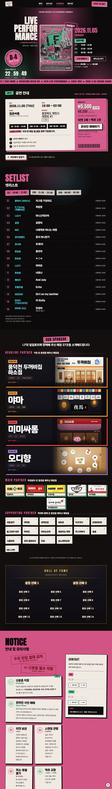

# I.F 2026 LIVE: 공연 홍보 사이트 + 온라인 예매 시스템

세명대학교 라이브공연 동아리 **I.F**의 35번째 정기 공연(2026.11.05, 제천 청춘싸롱)을 위해 만든 홍보 사이트와 예매 시스템이에요.
포스터만 보던 공연을 **홍보 → 예매 → 입금 확인 → 모바일 티켓 → 현장 입장**까지 한 흐름으로 묶었고, 실제 공연에서 그대로 운영했어요.

🔗 https://ifband.kro.kr

<p align="center"></p>

## 결과

| 순 방문자 | 온라인 예매 | 매출 | 현장 QR 입장 |
|:-:|:-:|:-:|:-:|
| **890명** | **128장** (입금 확인 66건) | **₩704,000** | **108명** |

방문자 수는 사이트가 직접 모은 익명 방문 통계(브라우저별 무작위 번호) 기준이에요.

## 기능

**손님 쪽**
- **온라인 예매:** 이름과 매수만 받아요. 전화번호는 받지 않아요.
- **입금 매칭:** 예매하면 네 자리 예매번호가 나오고, `입금자명 = 이름 + 번호`(예: `홍길동2384`)로 보내게 해요. 은행 앱의 입금 내역과 바로 짝이 맞아요.
- **QR 티켓:** 운영진이 입금을 확인하면 손님 화면이 저절로 "입금 확인 완료" 티켓으로 바뀌어요. 링크를 잃어버려도 이름과 번호로 다시 찾을 수 있어요.
- **셋리스트:** 무대별 곡 목록과 곡마다 누르는 "기대돼요" 하트가 있어요.
- **후원사 페이지:** 함께해 준 동네 가게 27곳을 직접 그린 간판 카드로 소개해요.
- **숨은 재미:** 명예의 전당 현판을 다섯 번 누르면 꽃이 한 송이 피어요. 모든 손님이 같은 꽃밭을 봐요.
- **가챠 추첨:** 공연 중 큰 화면(`gacha.html`)에서 티켓 번호로 경품을 뽑아요. 서버 시계에 맞춰 모든 화면이 같은 순간을 보여 줘요.

**운영진 쪽**
- 입금 대기, 입장 전, 전체, 취소 탭으로 나눈 관리 화면이 있어요. 검색창에 번호 네 자리만 치면 바로 찾아요.
- **카메라 QR 입장 처리:** 스태프 폰으로 티켓 QR을 찍으면 이름과 예매번호가 뜨고, [밴드 채움] 한 번이면 입장 처리가 끝나요.
- 명단을 CSV로 받거나 인쇄용 명단으로 뽑을 수 있어요. 서버가 꺼져도 명단이 남게 하려는 기능이에요.
- 방문 통계(유입 경로, 페이지별 방문)를 볼 수 있어요.

## 구조

```
[손님 폰] ──https──> Caddy (자동 HTTPS)
                      ├─ /          → site/   정적 파일 (빌드 없음)
                      ├─ /api/*     → 127.0.0.1:8787  Python 예매 서버 (표준 라이브러리만)
                      └─ /<비밀 주소> → 관리 화면 (사이트 폴더 밖)
```

- **한 대의 PC**에서 Caddy, 정적 사이트, Python API를 모두 돌렸어요. 따로 서버를 빌리지 않았어요.
- **예매 서버** (`server/api/app.py`)는 외부 패키지 없이 표준 라이브러리만 써요. 자료는 JSON 파일 하나에 원자적으로 교체해서 쓰고, 쓰기 전마다 백업을 남겨요.
- **보안:** 관리자 세션은 HMAC 서명 쿠키로 하고, 로그인 시도 횟수를 제한해요. `/api/*` 응답은 `no-store`로 캐시를 막아요.
- **인증서:** `kro.kr`은 여러 사람이 함께 쓰는 도메인이라 Let's Encrypt 주간 한도가 늘 차 있어요. 그래서 ZeroSSL로 발급받았어요.
- **프론트엔드:** 빌드 도구 없이 ES 모듈로 짰어요. 모션은 GSAP, ScrollTrigger, Lenis를 쓰고 `prefers-reduced-motion`을 지켜요.

<details>
<summary>전체 페이지 보기</summary>
<p align="center"></p>
</details>

## 로컬에서 돌려보기

```bash
# 1) 정적 사이트만 보기
cd site
py -m http.server 8080          # → http://localhost:8080

# 2) 예매 서버까지 (Python 3, 설치할 패키지 없음)
cp server/api/config.example.json server/api/config.json   # 값 채우기
py -3 server/api/app.py         # 127.0.0.1:8787
```

예매 화면(`/ticket`)까지 붙여 보려면 Caddy로 `/api/*`를 8787로 넘겨야 해요 (`server/Caddyfile` 참고).

## 보안 메모

- 계좌, 관리자 비밀번호, 관리 화면 주소, 인증서 API 키는 **코드에 없어요.**
  - `server/api/config.json`이나 환경 변수(`IF_ADMIN_PASSWORD`, `IF_STAFF_PATH`, `ZEROSSL_API_KEY`, `STAFF_PATH`)에서 읽어요.
  - 이 파일들은 `.gitignore`로 저장소에서 빠져 있어요.
  - 관리자 비밀번호가 비어 있으면 관리 화면 로그인이 아예 막혀요.
- 이 공개 저장소에서 뺀 것:
  - 예매 기록, 방문 기록, 서명 키
  - 관리 화면 HTML
  - 멤버들이 연주한 커버곡 클립 (원곡 저작권 때문)
  - 연락처와 졸업 선배님 실명 (가명으로 바꿨어요)
